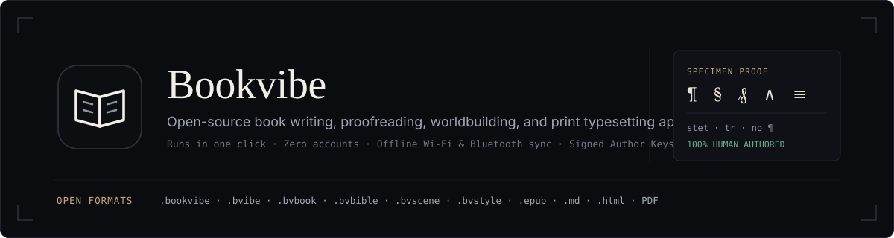
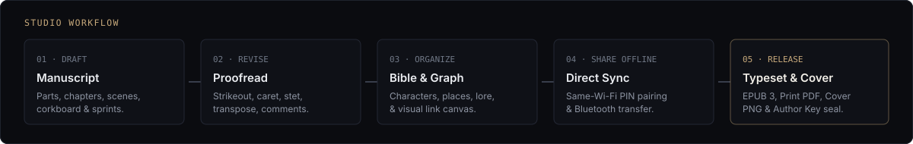
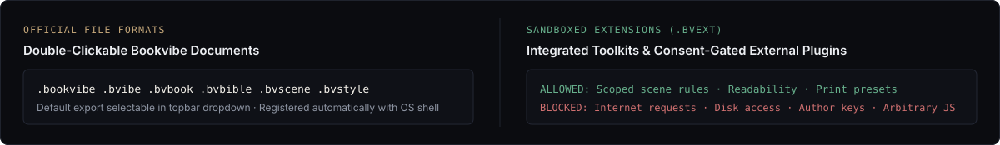

<p align="center">
  
</p>

<p align="center">
  
</p>

Bookvibe is a cross-platform desktop book writing, proofreading, worldbuilding, and print typesetting application. It runs in one click without setup, stores books locally, syncs offline over Wi-Fi or Bluetooth, and opens double-clickable native files directly from your file manager.

<p align="center">
  
</p>

## Key Capabilities

- **One-Click Native Execution**: Standalone builds for Windows (`.exe` / `.msi`), macOS (`.dmg` / `.app`), and Linux (`.AppImage` / `.deb`), plus zero-setup launchers (`Start-Bookvibe.bat`, `Start-Bookvibe.command`, `start-bookvibe.sh`).
- **Interactive Proofreading Studio**: Select words or sentences on the page to apply standard copyediting marks (`₰` Cross-Out, `∧` Caret Insert, `⇄` Substitute, `AQ` Margin Comment, `★` Highlight, `tr` Transpose, `stet`, `¶`, `no ¶`, `⏝`, `#`, `≡`, `lc`, `ital`, `bf`) with automatic Revision Snapshot backups and Clean Preview.
- **Sandboxed Extensions & Permissions**: Pre-bundled **Integrated** toolkits (Editorial Proofing, Typographic Cleanup, Readability Ledger, Print Trim Presets) plus **External (`.bvext`)** community plugins that enforce explicit permission consent, per-scope revocation, zero network/disk access, and a live Data Access Audit Log.
- **Multi-Book Library & Author Keys**: Keep multiple books organized with per-book Pen Names, drawn/typed Signatures, and local cryptographic Author Keys sealed into exported editions.
- **Offline Desktop-to-Desktop Collaboration**: Co-author and proofreader credits, scene annotations, 6-digit PIN same-Wi-Fi LAN sync, and OS Bluetooth / Nearby Share file exchange without internet access.
- **Story Bible & Interactive Story Graph**: Custom worldbuilding categories and fields alongside a zoomable, draggable relationship graph connecting characters, locations, lore, plot beats, and scenes.
- **Typeset Engine & Book Cover Studio**: Live paginated trim previews (`5" × 8"`, `5.5" × 8.5"`, `6" × 9"`, `A5`), drag-and-drop front/back wrap cover designer, and one-click export in `.bookvibe`, `.epub`, `.md`, `.html`, `.txt`, `.bvbook`, `.bvbible`, `.bvscene`, or `.bvstyle` via the topbar default export selector.
- **Human Authorship Only**: Zero AI features, zero telemetry, and full local ownership of every draft.

## Documentation & Icon Guide

- **[docs/GUIDE.md](docs/GUIDE.md)** — Reference manual covering every icon, custom hover/click-to-expand tooltips, proofreading symbols, external `.bvext` extension authoring & permission scopes, and default export formats.
- **[docs/OFFICIAL-EXTENSION-REGISTRATION.md](docs/OFFICIAL-EXTENSION-REGISTRATION.md)** — Official IANA RFC 6838 MIME templates, FreeDesktop `shared-mime-info` rules, Windows ProgID registry specs, and JSON Schema (`"magic": "BOOKVIBE_V1"`).

## Quick Start

### Option A: Double-Click Launcher
- **Windows**: Double-click `Start-Bookvibe.bat` (or drag any `.bookvibe` / `.bvscene` file onto it).
- **macOS**: Double-click `Start-Bookvibe.command`.
- **Linux**: Run `./start-bookvibe.sh` (or pass a file path: `./start-bookvibe.sh examples/the-salt-cartographer.bookvibe`).

### Option B: Developer Build
```bash
npm install
npm run typecheck
npm test
npm run tauri:dev
```

Build a standalone native installer/executable:
```bash
npm run tauri:build
```

## Keyboard Shortcuts

- `Ctrl/Cmd + S`: Capture Revision Snapshot in Editor (or export default format elsewhere)
- `Ctrl/Cmd + O`: Open any Bookvibe document or `.bvext` extension bundle
- `Ctrl/Cmd + Shift + F`: Toggle Zen Focus mode
- `Ctrl/Cmd + B` / `Ctrl/Cmd + I`: Bold / Italic Markdown emphasis
- `?` or `F1` (on focused control): Expand detailed help card for the active button

## License

Released under the [MIT License](LICENSE).
