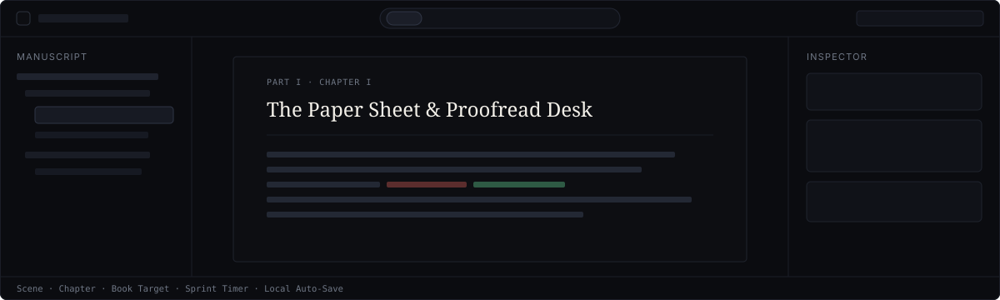

<p align="center">
  
</p>

**Quillvibe** is a cross-platform book writing app built so writers can draft notes, organize manuscripts, edit with right-click proofreading marks, manage story bibles and relationship graphs, install custom fonts, design layered print covers, and export release-ready books from one local workspace. It starts in **Ivory Light** with **Basic / Intermediate / Advanced** tool levels in Settings, runs offline with zero AI features and zero account sign-ins, stores work in protected `QVBX` binary files (`.qv`, `.qvbible`, `.qvscene`, `.qvstyle`), supports importing legacy `.quillvibe` and `.bookvibe` files, and syncs drafts over Wi-Fi, Bluetooth, or self-hosted HTTPS servers. Published under **`jhonrey.com`**.

> **Open Quillvibe in Your Browser (`/start` Welcome & `/course` Academy):** **[Launch `https://quillvibe.jhonrey.com/start`](https://quillvibe.jhonrey.com/start)**  
> *Browser tip:* Click **Save** anytime to export a `.qv` file locally so your work stays backed up if browser site data is cleared. Installing a desktop release saves automatically to your computer.  
> **Desktop Releases (`v2.2.0` — Windows `.msi`/`.exe`, macOS Universal `.dmg`, Linux `.AppImage`/`.deb`):** **[Download From GitHub Releases](https://github.com/jhonrey-com/Quillvibe/releases/latest)**  
> **Project Wiki & Roadmap:** **[Quillvibe GitHub Wiki](https://github.com/jhonrey-com/Quillvibe/wiki)** · **Security Reporting:** **[SECURITY.md](SECURITY.md)** (`quillvibe@jhonrey.com`)

<p align="center">
  
</p>

---

## Table of Contents

1. [Why Keep Everything in One Workspace](#1-why-keep-everything-in-one-workspace)
2. [How to Install, Run in Browser & Launch Quillvibe](#2-how-to-install-run-in-browser--launch-quillvibe)
3. [Guides by Writing Level (Basic, Intermediate, Advanced)](#3-guides-by-writing-level-basic-intermediate-advanced)
4. [All Studio Workspaces, Bottom Sprint Controls & Icon Legend](#4-all-studio-workspaces-bottom-sprint-controls--icon-legend)
5. [Custom Fonts, Cover Studio & Migration](#5-custom-fonts-cover-studio--migration)
6. [Protected File Formats, Password Locks & Author Keys](#6-protected-file-formats-password-locks--author-keys)
7. [Extensions, Permissions & Developer Add-ons](#7-extensions-permissions--developer-add-ons)
8. [Keyboard Shortcuts](#8-keyboard-shortcuts)
9. [FAQ, Security & Contributing](#9-faq-security--contributing)

---

## 1. Why Keep Everything in One Workspace

Many writers split work across five programs: a text editor for Markdown notes, spreadsheets for outlines, whiteboard apps for plot graphs, image editors for covers, and conversion scripts for EPUB files. Quillvibe replaces that chain with integrated tools sharing one local project:

- **Zero setup & zero accounts**: Open an example or blank project right away. Every `.qv` file is saved in a protected `QVBX` binary container that only Quillvibe decodes, with optional password locking and tamper detection.
- **Works cleanly for small notes or multi-volume books**: Write freely with optional spellcheck off by default, use global `Ctrl+Z`/`Ctrl+Y` undo/redo across all studios, or manage a full catalog under separate pen names.
- **Real proofreading workflow**: Instead of overwriting prose blindly, apply 15 copyediting marks on the page, toggle *Clean Preview*, and accept edits with automatic snapshot backups.
- **Commercial publishing basics built in**: Configure publisher company, print and eBook ISBN-13, commercial rights, custom device fonts (`.ttf`, `.otf`, `.woff`, `.woff2`), full jacket cover wraps (front, spine, back, and flaps), Origin Author & Device Keys (`QVK-`/`QVD-`), Work Copyright Seals (`QVC-`), and Verified Multi-Device Co-Author tokens (`QVCA1.`).

---

## 2. How to Install, Run in Browser & Launch Quillvibe

### Option A: Open Immediately in Any Browser (No Login Required)
Visit **[https://quillvibe.jhonrey.com/](https://quillvibe.jhonrey.com/)** to write, organize Story Bibles, proofread, design covers, and export `.qv` / `.pdf` / `.epub` / `.md` files right in your browser. Click **Save** locally whenever finishing a browser session so your `.qv` file is stored safely outside browser cache.

### Option B: Desktop Installers (Frameless Native App with Local Auto-Save)
Download from **[GitHub Releases (`v2.2.0`)](https://github.com/jhonrey-com/Quillvibe/releases/latest)** (signed under publisher **`jhonrey.com`**, opens maximized on first launch, and saves directly to disk):
- **Windows:** `.msi` or `.exe`
- **macOS:** Universal `.dmg` (Apple Silicon & Intel)
- **Linux:** `.AppImage` or `.deb`

Desktop builds also add `F11` Immersive Fullscreen mode (with a movable, collapsible bar and top-edge screen hover menu), multi-window book editing, Same-Wi-Fi PIN sync, OS Bluetooth transfer, and double-click opening for `.qv`, `.qvbible`, `.qvscene`, and `.qvstyle` files.

### Option C: Terminal Installers

**Windows (PowerShell):**
```powershell
irm https://raw.githubusercontent.com/jhonrey-com/Quillvibe/main/scripts/install.ps1 | iex
```
*(Or Winget manifest `packaging/winget/jhonrey.Quillvibe.yaml`.)*

**macOS & Linux:**
```bash
curl -fsSL https://raw.githubusercontent.com/jhonrey-com/Quillvibe/main/scripts/install.sh | sh
```
*(Or Homebrew Cask via `packaging/homebrew/quillvibe.rb`.)*

### Option D: One-Click Repo Launchers & Source Build
- **Windows / macOS / Linux repo launchers:** `Start-Quillvibe.bat`, `Start-Quillvibe.command`, or `./start-quillvibe.sh`
- Requirements from source: Node.js 20+ (and Rust toolchain for `npm run tauri:build`)

```bash
git clone https://github.com/jhonrey-com/Quillvibe.git
cd Quillvibe
npm install

# Start browser UI preview at http://localhost:1420
npm run dev

# Or run / bundle the native desktop app
npm run tauri:dev
npm run tauri:build
```

---

## 3. Guides by Writing Level (Basic, Intermediate, Advanced)

### Level 1 — Basic: Quick Notes, Journal Scenes & Markdown Builder
1. Open Quillvibe. The Welcome view lets you start a blank book, explore the sample book, open a `.qv` file, or take the full Academy course at `/course`.
2. Click inside **Manuscript** (`Draft` mode) and type directly on **Ivory**, **Parchment**, or **Obsidian** paper.
3. Use `Ctrl/Cmd+B`, `Ctrl/Cmd+I`, `H2`, blockquote `❝`, `* * *`, or right-click directly on the page to format Markdown.
4. Change the topbar Save format dropdown to **`.md` (Markdown)** or **`.qvscene` (Single Scene)** and click Save (`Ctrl+S` in non-editor views exports directly; in Editor `Ctrl+S` captures a revision snapshot).

### Level 2 — Intermediate: Series Worldbuilding, Proofing & Live Story Graph
Change **Workspace Tool Level** in **Settings -> Workspace & Editor** to enable Corkboard, Outline, Proofread Mode, and Interior Print Typesetting.
- **Proofread Mode**: Highlight any sentence and right-click to apply 15 copyediting marks (`₰`, `∧`, `⇄`, `tr`, `stet`, `AQ`, and more), toggle **Clean Preview**, and accept edits with automatic snapshot backups.

### Level 3 — Advanced: Cover Studio, Permanent Author Keys, Permissions & Commercial Publishing
1. **Multi-Book Library, Origin Device Keys & Copyright Seals**: Open **Library** to keep multiple manuscripts, draw ink signatures, bind an **Origin Author & Device Key** (`QVK-`/`QVD-`) to each pen name, and register a **Work Copyright Seal** (`QVC-`).
2. **Verified Multi-Device Co-Authoring & Restrictions**: Open **Collaborate** to verify co-authors using signed `QVCA1.` tokens generated on a separate device and assign per-role edit/export restrictions.
3. **Migrate From `.docx`, Web HTML & Legacy Archives**: Open **Settings -> Publishing, Commercial & Migration** to import `.docx`, `.html`, `.rtf`, `.md`, `.txt`, or legacy `.quillvibe`/`.bookvibe` files.

---

## 4. All Studio Workspaces, Bottom Sprint Controls & Icon Legend

Press `F1` or click **Help (`?`)** inside the app to search every slider, lever, dropdown, icon, and section live, or read **[docs/FAQ-AND-CONTROLS.md](docs/FAQ-AND-CONTROLS.md)**.

---

## 5. Custom Fonts, Cover Studio & Migration

- **Settings -> Typefaces & Fonts**: Install `.ttf`, `.otf`, `.woff`, or `.woff2` fonts for Draft sheets, Interior Typeset, and Covers.
- **Studio -> Book Cover Studio**: Design Front, Back, Spine, and Dust Jacket Flaps with vector shapes, multi-layer text, gradients, filters, grid snap, smart alignment guides, and PNG/EPUB export.

---

## 6. Protected File Formats, Password Locks & Author Keys

Every native Quillvibe file uses the binary `QVBX` container with AES-GCM encryption, SHA-256 integrity sealing, Author Key verification, and active-content/malware scanning. You can also export a **Password-Locked `.qv`** file for sensitive drafts.

| Extension | Role | Double-Click Action (Desktop App) |
| :--- | :--- | :--- |
| **`.qv`** | Complete Book Workspace | Opens manuscript, Story Bible, Graph, cover wrap, marks, snapshots, Origin Key, and Copyright Seal. |
| **`.qvbible`** | Story Bible Database | Merges Characters, Locations, Lore, and Custom Categories into the active book. |
| **`.qvscene`** | Single Scene Draft | Opens or imports one scene along with snapshots and proofreading marks. |
| **`.qvstyle`** | Typeset & Paper Style | Applies trim size, font stack, drop caps, smart quotes, margins, and paper theme. |

Legacy `.quillvibe`, `.qvibe`, `.qvbook`, `.bookvibe`, and `.bv*` archives are **not** registered for double-click opening; import them explicitly via **Settings -> Publishing, Commercial & Migration -> Import** or the Welcome screen import button.

More detail: [docs/OFFICIAL-EXTENSION-REGISTRATION.md](docs/OFFICIAL-EXTENSION-REGISTRATION.md) and [docs/GUIDE.md](docs/GUIDE.md).

---

## 7. Extensions, Permissions & Developer Add-ons

Quillvibe separates **Integrated** toolkits from external **`.qvext`** (and legacy `.bvext`) community add-ons. External manifests are declarative JSON validated with SHA-256 fingerprints, sandboxed against network calls or filesystem access, and gated behind checkbox consent. Read **[docs/DEVELOPER-EXTENSIONS.md](docs/DEVELOPER-EXTENSIONS.md)**.

---

## 8. Keyboard Shortcuts

| Keys | Command |
| :--- | :--- |
| `Ctrl / Cmd + Z` / `Y` | Undo / Redo across Manuscript, Corkboard, Outline, Bible, Graph, and Cover Studio |
| `Ctrl / Cmd + S` | Save Revision Snapshot in Manuscript view; export default format in other views |
| `Ctrl / Cmd + O` | Open any `.qv`, `.qvbible`, `.qvscene`, `.qvstyle`, or `.qvext` file |
| `Ctrl / Cmd + B` / `I` | Bold / Italic Markdown wrapping around selection |
| `Ctrl / Cmd + Shift + F` | Toggle Zen Focus mode |
| `F11` *(Desktop App)* | Toggle Immersive Fullscreen HUD with live clock, sprint timer, word count, and alarm |
| `F1` | Open the Help manual & Icon Legend |
| `Esc` | Close modal overlays, context menus, active walkthrough tour, or exit Zen Focus |

---

## 9. FAQ, Security & Contributing

- **Complete UI & FAQ Reference:** Read **[docs/FAQ-AND-CONTROLS.md](docs/FAQ-AND-CONTROLS.md)**.
- **Project Overview & Public Roadmap:** Browse the **[Quillvibe GitHub Wiki](https://github.com/jhonrey-com/Quillvibe/wiki)**.
- **Security & Vulnerability Reporting:** See **[SECURITY.md](SECURITY.md)** or email **quillvibe@jhonrey.com**.
- **Contributions:** Read **[CONTRIBUTING.md](CONTRIBUTING.md)** before opening pull requests.

## License

Released under the [MIT License](LICENSE).
